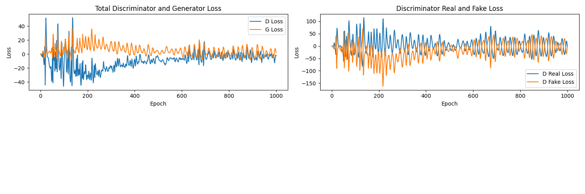
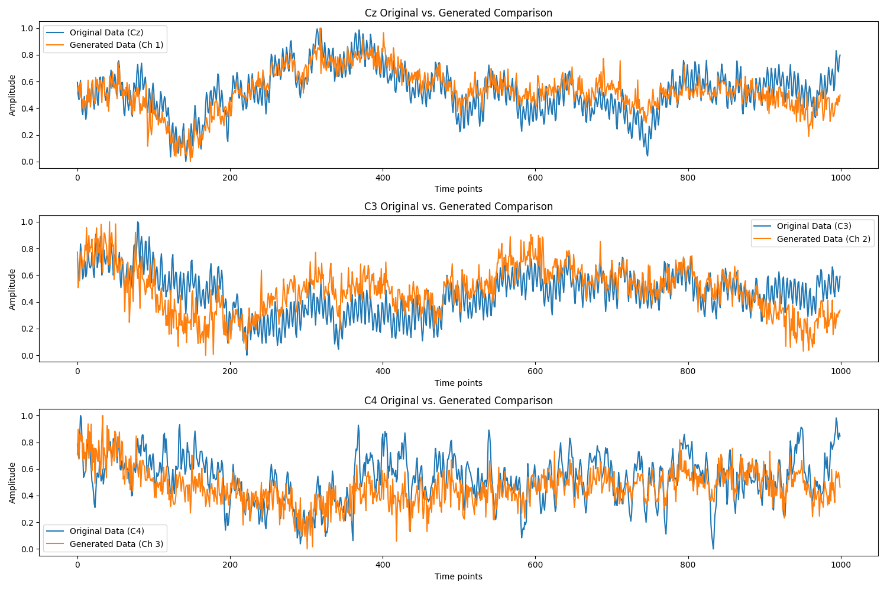

# Wasserstein Generative Adversarial Network with Common Spatial Patterns for Motor Imagery EEG Synthesis

**BSc Data Science & Computing Final Year Dissertation**  
Birkbeck College, University of London

---

## Overview

Non-invasive Electroencephalography (EEG) Brain-Computer Interfaces (BCIs) suffer from low signal-to-noise ratio (SNR), non-stationarity across recording sessions, and acute calibration data scarcity. Training reliable Motor Imagery (MI) classifiers typically requires hundreds of repetitive trials per user, causing fatigue and limiting clinical deployment.

This project investigates a **Wasserstein Generative Adversarial Network** conditioned on trial-level **Common Spatial Patterns (CSP)** features to synthesise multi-channel motor imagery EEG time-series data. By conditioning the generator and critic on spatially discriminative log-variance CSP vectors rather than binary class labels alone, the model learns to preserve subject-specific and session-specific sensorimotor rhythms across channels `Cz`, `C3`, and `C4`.

---

## Dataset & Preprocessing Pipeline

Experiments use the open-access **SHU Motor Imagery EEG Dataset** ([Ma et al., *Scientific Data*, 2022](https://doi.org/10.1038/s41597-022-01647-1); available on [Figshare](https://figshare.com/articles/software/shu_dataset/19228725)):

- **Cohort:** 25 healthy subjects across 5 recording sessions (11,988 clean trials in total after artefact rejection).
- **Paradigm:** Left-hand vs right-hand grasping motor imagery, sampled at $250\text{ Hz}$ across 32 Ag/AgCl channels (`standard_1005` montage) in 4-second epochs ($1000$ time steps per trial).
- **Sensorimotor Channel Selection (`data_preprocess.py`):** Extracts the three primary sensorimotor cortex electrodes: `C3` (contralateral right-hand MI), `C4` (contralateral left-hand MI), and `Cz` (midline bilateral motor cortex).
- **Filtering & Normalisation (`ws.py`, `data_loader.py`):**
  1. Bandpass FIR filter (`firwin`) between 3 Hz and 35 Hz to isolate the sensorimotor $\mu$ (8 to 12 Hz) and $\beta$ (13 to 30 Hz) rhythms.
  2. Per-trial min-max scaling to $[-1, 1]$ to match the generator's `Tanh` output range while preventing cross-session amplitude drift from dominating training.
  3. Z-score standardisation of the extracted CSP feature vectors per trial.

---

## Methodology

### 1. Common Spatial Patterns (CSP) Conditioning

For two motor imagery conditions $A$ (left hand) and $B$ (right hand), normalised trial covariance matrices $C_A$ and $C_B$ are computed and combined into a composite spatial covariance matrix:

$$C_{\text{composite}} = \frac{N_A C_A + N_B C_B}{N_A + N_B} = U \Lambda U^\top$$

Simultaneous diagonalisation yields spatial filters $W$ that maximise variance for one class while minimising variance for the other. The log-variance of the spatially projected signal forms the conditioning vector $y \in \mathbb{R}^3$:

$$y = \log\left(\text{var}(W^\top X)\right)$$

Within-session Linear Discriminant Analysis (LDA) on these extracted CSP features achieves up to **78%** baseline accuracy, confirming that $y$ encodes salient task-discriminative spatial structure.

### 2. Wasserstein Loss with Gradient Penalty

Standard GANs minimising Jensen-Shannon divergence suffer from vanishing gradients and mode collapse when the discriminator saturates on high-dimensional ($3 \times 1000$) time-series data. We instead optimise the Kantorovich-Rubinstein dual of the Wasserstein-1 distance with a 1-Lipschitz gradient penalty ([Gulrajani et al., 2017](https://arxiv.org/abs/1704.00028)):

$$\mathcal{L}_{\text{Critic}} = \mathbb{E}_{\tilde{x} \sim \mathbb{P}_g}[D(\tilde{x} \mid y)] - \mathbb{E}_{x \sim \mathbb{P}_r}[D(x \mid y)] + \lambda \, \mathbb{E}_{\hat{x} \sim \mathbb{P}_{\hat{x}}}\left[\left(\|\nabla_{\hat{x}} D(\hat{x} \mid y)\|_2 - 1\right)^2\right]$$

where $\hat{x} = \epsilon x + (1 - \epsilon)\tilde{x}$ for $\epsilon \sim \mathcal{U}(0, 1)$, and the critic is updated $n_{\text{critic}} = 10$ times per generator step using asymmetric Adam momentum ($\beta_1 = 0.5$ for $G$, $\beta_1 = 0.9$ for $D$, learning rate $1 \times 10^{-4}$ to $2 \times 10^{-4}$) and Xavier normal weight initialisation.

### 3. Evaluated Architectures (`GANs/`)

Four conditional architectures were systematically compared across training runs:

| Architecture | File | Generator / Critic Layers | Layer Types | Loss Function | Training Behaviour |
| :--- | :--- | :--- | :--- | :--- | :--- |
| **Conditional GAN** | `GANs/GAN.py` | 11 / 7 | Linear, BatchNorm1d, LeakyReLU, Sigmoid, Tanh | Binary Cross-Entropy | Discriminator saturates early; vanishing gradients and rapid mode collapse |
| **WGAN (Weight Clipping)** | `GANs/DC_WC_GAN.py` | 11 / 16 | Conv1d, Linear, BatchNorm1d | Wasserstein ($c \in [0.1, 1.0]$) | Reduced loss oscillation, but weight clipping restricts critic capacity and yields homogeneous trials |
| **Conditional DC-GAN** | `GANs/DC_GAN.py` | 11 / 16 | Conv1d, Upsample, BatchNorm1d, Dropout | Binary Cross-Entropy | Captures coarse envelopes but lacks fine temporal variability |
| **Conditional WGAN-GP** | `GANs/WGAN.py` & `GANs/DC_WGAN_GP.py` | 16 / 7 (MLP) & 11 / 16 (Conv1d) | Linear / Conv1d, BatchNorm1d, LeakyReLU(0.02), Tanh | Wasserstein + Gradient Penalty ($\lambda \in [0.1, 10]$) | Stable critic-generator equilibrium over 500 to 1,000 epochs without mode collapse |

---

## Results & Fidelity Evaluation

### 1. Adversarial Convergence

Introducing the gradient penalty and asymmetric critic updates (`n_critic = 10`) eliminated the discriminator saturation seen in standard BCE training, producing bounded, coupled critic and generator loss trajectories across 1,000 epochs:



### 2. Temporal & Channel-Specific Fidelity (`Cz`, `C3`, `C4`)

Trained on Sessions 1 to 5 of Subjects 1 to 20 and evaluated on unseen test subjects (Subjects 21 to 25) conditioned solely on their CSP vectors, the generator captures population-level amplitude trends and distinct channel dynamics across `Cz`, `C3`, and `C4`:



### 3. Multi-Metric Signal Analysis

Generated samples were evaluated across three complementary criteria:

1. **Semi-Supervised SVM Label Alignment (`classification_report.txt`):** An SVM classifier trained on real data (achieving **80% accuracy**, macro F1 = **0.80** across 11,988 trials) was used to evaluate class balance in synthetic Session 5 trials across all 25 subjects, matching true left/right trial counts closely on low-artefact subjects (exact 50/50 and 46/46 alignment on Subjects 001, 010, 014, and 016).
2. **t-SNE Manifold Overlap:** 2D t-SNE embeddings confirm that synthetic trials intersperse across the empirical data manifold on clean recordings, while revealing overfitting to high-amplitude ocular/muscular artefacts on noisy test subjects (such as Subject 021).
3. **Spatial Covariance & Inter-Trial Coherence (ITC):** MNE Morlet wavelet ITC analysis and channel covariance comparisons show that while WGAN-GP preserves broad channel scaling, fully connected layers smooth out phase-locked event-related potentials (ERPs) around the $200\text{ ms}$ cue onset.

---

## Repository Structure

```text
├── GANs/
│   ├── GAN.py                        # Baseline Conditional MLP GAN (BCE loss)
│   ├── WGAN.py                       # Conditional WGAN-GP with Xavier init & asymmetric Adam
│   ├── DC_GAN.py                     # 1D Convolutional Conditional GAN
│   ├── DC_WC_GAN.py                  # 1D Convolutional WGAN with weight clipping
│   └── DC_WGAN_GP.py                 # 1D Convolutional Conditional WGAN-GP
├── data_preprocess.py                # MNE raw creation, 10-05 montage setup, and 3-35 Hz FIR filtering
├── ws.py                             # Common Spatial Patterns (CSP) feature extractor
├── data_loader.py                    # PyTorch Dataset with per-trial [-1, 1] scaling & feature normalisation
├── train_GAN.py                      # Main training entrypoint across subject/session splits
├── wgan_eval_and_save.py             # Evaluation script for generating synthetic subject/session cohorts
├── data_comparison.py                # Channel-wise visual comparison (Cz, C3, C4)
├── classification_report.txt         # Baseline SVM classification report on the 11,988-trial dataset
├── figures/                          # Saved loss curves and real vs synthetic EEG comparison plots
└── requirements.txt                  # Python dependencies
```

---

## Usage

### 1. Install Dependencies

```bash
pip install -r requirements.txt
```

### 2. Prepare SHU Dataset & Extract CSP Features

Download the SHU Motor Imagery dataset from [Figshare](https://figshare.com/articles/software/shu_dataset/19228725) and extract the CSP conditioning vectors using `ws.py` and `data_preprocess.py`.

### 3. Train Conditional WGAN-GP

Update `data_dir` and `feature_dir` in `train_GAN.py` to point to your local dataset directory, select the desired model architecture (`WGAN` or `WGAN_GP`), and run:

```bash
python train_GAN.py
```

### 4. Generate & Evaluate Synthetic Trials

Generate synthetic cohorts for held-out subjects/sessions and plot channel comparisons:

```bash
python wgan_eval_and_save.py
python data_comparison.py
```

---

## Licence

Released under the [MIT Licence](LICENSE).
